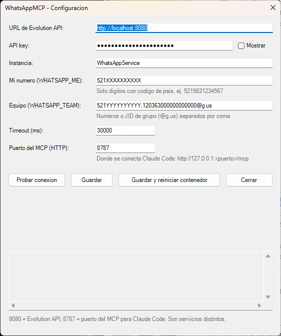
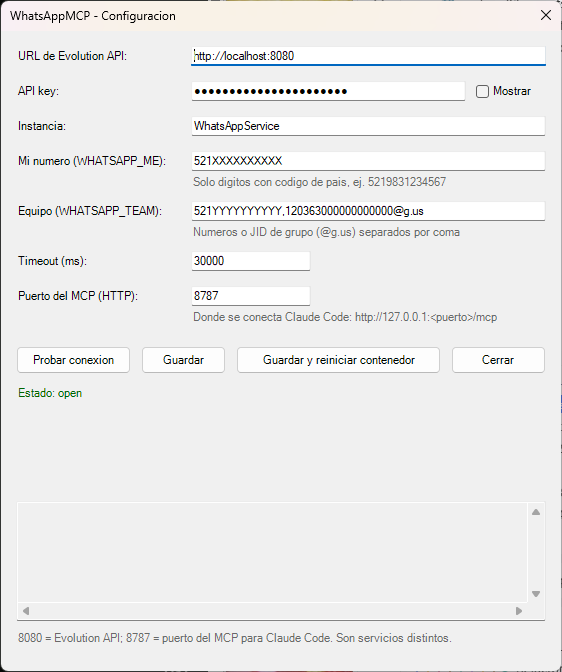
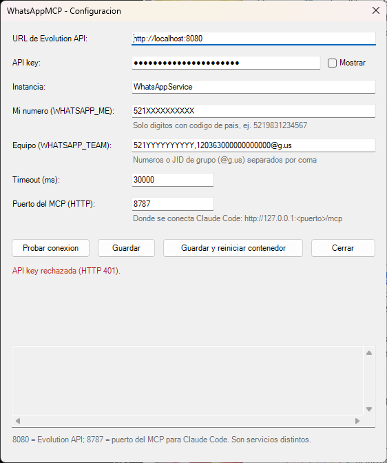

# neto-whatsappmcp: avisos por WhatsApp desde tu asistente de IA

Con este proyecto, tu asistente de IA (Claude, Gemini o Codex) puede **mandarte un mensaje de WhatsApp**. Por ejemplo, cuando termina una tarea larga, cuando necesita que tomes una decisión o cuando algo falla. También puede avisar a tu equipo, mandar un reporte como archivo adjunto y listar tus grupos.

No necesitas saber programar: esta guía te lleva de cero hasta tu primer mensaje, paso a paso. Si sabes usar una terminal (la ventana negra donde se escriben comandos), puedes hacerlo.

## Índice

1. [¿Cómo funciona? (con analogías)](#1-cómo-funciona-con-analogías)
2. [Qué necesitas instalar](#2-qué-necesitas-instalar)
3. [Paso a paso: de cero al primer mensaje](#3-paso-a-paso-de-cero-al-primer-mensaje)
4. [Personalizar tu API key de Evolution](#4-personalizar-tu-api-key-de-evolution)
5. [Por qué usamos la versión v2.3.7 de Evolution](#5-por-qué-usamos-la-versión-v237-de-evolution)
6. [Variables del archivo `.env`](#6-variables-del-archivo-env)
7. [Conectar tu asistente (Claude, Gemini, Codex)](#7-conectar-tu-asistente-claude-gemini-codex)
8. [Ejemplos de uso](#8-ejemplos-de-uso)
9. [Avisos automáticos con hooks de Claude Code](#9-avisos-automáticos-con-hooks-de-claude-code)
10. [Seguridad](#10-seguridad)
11. [Solución de problemas](#11-solución-de-problemas)
12. [Ventana de configuración (opcional, solo Windows)](#12-ventana-de-configuración-opcional-solo-windows)
13. [Para desarrolladores](#13-para-desarrolladores)
14. [Aviso legal y licencia](#14-aviso-legal-y-licencia)

---

## 1. ¿Cómo funciona? (con analogías)

Hay tres piezas que trabajan en cadena:

```
Tu asistente de IA  --->  MCP (este proyecto)  --->  Evolution API  --->  WhatsApp
   (el cliente)           puerto 8787                  puerto 8080
```

Piensa en un restaurante: tu asistente es el **cliente** que pide, el **MCP** es el **mesero** que entiende el pedido y lo traduce, y **Evolution** es la **cocina** que sabe hablar con WhatsApp.

| Palabra | Qué significa, sin tecnicismos |
|---|---|
| **Docker** | Una "caja cerrada" donde un programa corre con todo lo que necesita. No instalas el programa en tu computadora: Docker lo ejecuta dentro de su caja y, si lo borras, no deja basura. |
| **Docker Compose** | La "receta" (un archivo) que le dice a Docker qué cajas levantar y cómo conectarlas. En este proyecto hay dos recetas, explicadas abajo. |
| **API key** | Una **contraseña larga para programas**. Evolution solo atiende a quien le muestra esa clave. La inventas tú (sección 4). |
| **MCP** | Un "enchufe estándar" que permite a un asistente de IA usar herramientas externas. Este MCP le da cuatro herramientas: enviar texto, enviar documento, listar grupos y ver el estado de la conexión. |
| **Evolution API** | Un programa gratuito que se conecta a tu WhatsApp (como lo hace WhatsApp Web) y permite que otros programas manden mensajes por él. |
| **Instancia** | Una "línea de WhatsApp" dentro de Evolution. Cada instancia está vinculada a un teléfono. Tú creas una y le pones nombre. |
| **QR** | El cuadro de puntitos que escaneas con tu celular para vincular WhatsApp, igual que cuando abres WhatsApp Web en una computadora. |
| **Postgres y Redis** | La "libreta" (base de datos) y la "memoria rápida" que usa Evolution. Se instalan solos dentro de Docker; no tienes que tocarlos. |

### Por qué hay dos archivos compose

| Archivo | Qué levanta |
|---|---|
| `docker-compose.evolution.yml` | **Evolution** + su base de datos (Postgres) + Redis. Es "la cocina". |
| `docker-compose.yml` | Solo el **servidor MCP** de este proyecto. Es "el mesero". |

Si ya tienes tu propio Evolution funcionando, **no necesitas** el primer archivo: solo apunta `EVOLUTION_BASE_URL` a tu Evolution. Ojo: `docker compose up -d` (sin `-f`) levanta **solo el MCP**. Para Evolution siempre escribes `-f docker-compose.evolution.yml`.

---

## 2. Qué necesitas instalar

- **Docker Desktop** (Windows o Mac) o Docker Engine con el plugin Compose (Linux): https://www.docker.com/products/docker-desktop/ . Después de instalarlo, ábrelo y espera a que diga que está funcionando.
- **Git**, para descargar el proyecto: https://git-scm.com/downloads
- **Al menos un asistente de IA** que soporte MCP:
  - Claude Code (terminal o extensión de VS Code) o Claude Desktop
  - Gemini CLI
  - Codex CLI
- **Un teléfono con WhatsApp** (el que vas a vincular).
- **Node 24**: solo si vas a desarrollar el proyecto o a usar los hooks de Claude Code (sección 9). Para lo demás no hace falta.

Los comandos de esta guía se escriben en una terminal: en Windows usa **PowerShell**; en Mac o Linux usa la **Terminal**. Cuando un comando cambia según el sistema, se muestran los dos.

---

## 3. Paso a paso: de cero al primer mensaje

### Paso 1. Descargar el proyecto

```
git clone https://github.com/wlnaim/neto-whatsappmcp.git
cd neto-whatsappmcp
```

Todo lo que sigue se escribe **dentro de la carpeta `neto-whatsappmcp`**.

### Paso 2. Crear tu archivo `.env`

El archivo `.env` guarda tus claves y ajustes. **Es tuyo y nunca se sube a GitHub.** Se crea copiando la plantilla:

```powershell
# Windows (PowerShell)
Copy-Item .env.example .env
```

```bash
# Mac / Linux
cp .env.example .env
```

### Paso 3. Inventar tu API key y tu contraseña de base de datos

Necesitas dos textos largos y aleatorios. Genéralos con estos comandos (cada vez que lo ejecutas sale uno distinto):

```powershell
# Windows (PowerShell): API key
$b = New-Object byte[] 32; (New-Object Security.Cryptography.RNGCryptoServiceProvider).GetBytes($b); -join ($b | ForEach-Object { $_.ToString('x2') })
```

Ejecútalo **otra vez** para obtener la contraseña de la base de datos (es otro texto distinto).

```bash
# Mac / Linux
openssl rand -hex 32    # API key
openssl rand -hex 16    # contraseña de la base de datos
```

Ahora abre el archivo `.env` con un editor de texto (`notepad .env` en Windows, `nano .env` en Mac/Linux) y reemplaza los textos de ejemplo:

```
EVOLUTION_API_KEY=pega-aquí-el-primer-texto
EVOLUTION_DB_PASSWORD=pega-aquí-el-segundo-texto
```

Reglas: sin comillas, sin espacios alrededor del `=` y, en la contraseña, **solo letras y números** (los textos que generaste ya cumplen esto).

### Paso 4. Levantar Evolution

Asegúrate de que Docker Desktop esté abierto y ejecuta:

```
docker compose -f docker-compose.evolution.yml up -d
```

La primera vez descarga varios archivos y puede tardar unos minutos. Para comprobar que funciona, abre en tu navegador **http://localhost:8080** . Debe aparecer un mensaje parecido a este (en inglés) con el número de versión:

```
{"status":200,"message":"Welcome to the Evolution API, it is working!","version":"2.3.7", ...}
```

Si no abre, espera medio minuto y recarga.

### Paso 5. Crear la instancia y vincular tu WhatsApp (el QR)

1. Abre el panel de Evolution: **http://localhost:8080/manager/** (viene incluido; no hay que instalar nada más).
2. Para entrar te pide la **URL del servidor** (`http://localhost:8080`) y la **API key** (la que pusiste en `EVOLUTION_API_KEY`). Los nombres exactos de los campos pueden variar un poco.
3. Crea una instancia nueva: ponle un nombre sencillo, por ejemplo `mi-whatsapp` (solo letras, números y guiones), y como tipo de conexión elige **WHATSAPP-BAILEYS**.
4. El panel muestra un **código QR**. En tu celular abre WhatsApp, entra a **Configuración (o Ajustes) > Dispositivos vinculados > Vincular un dispositivo** y escanea el QR. Si el QR caduca, genera otro desde el panel.
5. Cuando el panel marque la instancia como conectada (estado `open`), listo.

> Los nombres exactos de los botones del panel pueden cambiar entre versiones y no se verificaron uno por uno (sin verificar). Lo importante es: crear la instancia, ver el QR y escanearlo.

Alternativa sin panel (para quien prefiera la terminal). Reemplaza `TU_API_KEY` por tu clave:

```
curl.exe -X POST http://localhost:8080/instance/create -H "apikey: TU_API_KEY" -H "Content-Type: application/json" -d "{\"instanceName\":\"mi-whatsapp\",\"qrcode\":true,\"integration\":\"WHATSAPP-BAILEYS\"}"
```

(En Mac/Linux usa `curl` y comillas simples alrededor del JSON: `-d '{"instanceName":"mi-whatsapp","qrcode":true,"integration":"WHATSAPP-BAILEYS"}'`.) La respuesta incluye el QR en formato base64, que es más cómodo de ver en el panel.

Para comprobar el estado de la conexión: `curl.exe -H "apikey: TU_API_KEY" http://localhost:8080/instance/connectionState/mi-whatsapp` (verás `"state":"open"` cuando esté conectada).

### Paso 6. Decirle al MCP cuál es tu instancia y tu número

Abre `.env` otra vez y completa:

```
EVOLUTION_INSTANCE=mi-whatsapp
WHATSAPP_ME=52XXXXXXXXXX
WHATSAPP_TEAM=
```

- `EVOLUTION_INSTANCE`: el nombre exacto que le pusiste a la instancia.
- `WHATSAPP_ME`: **tu número** con código de país y **solo dígitos**: sin `+`, sin espacios, sin guiones. Ejemplo ficticio de México: `52XXXXXXXXXX` (52 = código de país, seguido de tu número). El mensaje te llegará a ti mismo, en el chat "Tú".
- `WHATSAPP_TEAM`: déjalo vacío (como arriba) si no vas a usar grupos. Más adelante se explica cómo llenarlo.

Deja `EVOLUTION_BASE_URL=http://localhost:8080` como está.

### Paso 7. Construir y levantar el MCP

```
docker compose up -d --build
```

La primera vez construye la imagen `whatsapp-mcp` (unos minutos). Comprueba que está vivo:

```powershell
# Windows (PowerShell)
curl.exe http://127.0.0.1:8787/healthz
```

```bash
# Mac / Linux
curl http://127.0.0.1:8787/healthz
```

Debe responder `ok`. (También puedes abrir esa dirección en el navegador.)

### Paso 8. Mandar tu primer mensaje de prueba

Sin usar todavía ningún asistente, prueba el envío con la herramienta de línea de comandos del proyecto, que corre dentro de Docker:

```
docker run --rm --env-file .env --entrypoint node whatsapp-mcp dist/cli.js send --to me "Hola desde mi MCP"
```

Debe imprimir una línea como `✔ 52XXXXXXXXXX enviado` y el mensaje llega a tu WhatsApp. Si dice error, ve a la [sección 11](#11-solución-de-problemas).

(Si tienes Node 24, también puedes usar `npm ci`, `npm run build` y `node dist/cli.js send ...`, pero entonces las variables del `.env` deben estar cargadas en tu terminal: Node no lee el `.env` por sí solo.)

### Paso 9. Conectar tu asistente

Sigue la [sección 7](#7-conectar-tu-asistente-claude-gemini-codex) con el asistente que uses y pídele: "Avísame por WhatsApp que ya quedó todo listo".

### Cómo apagar o encender todo

```
docker compose down                                          # apaga el MCP
docker compose -f docker-compose.evolution.yml down          # apaga Evolution (conserva tu WhatsApp vinculado)
docker compose up -d                                         # enciende el MCP
docker compose -f docker-compose.evolution.yml up -d         # enciende Evolution
```

No uses `down -v` en Evolution: el `-v` **borra los datos** (y tendrías que escanear el QR otra vez). Los contenedores arrancan solos cuando Docker Desktop se inicia (`restart: unless-stopped`).

---

## 4. Personalizar tu API key de Evolution

**Qué es:** la contraseña con la que programas (como este MCP) piden cosas a Evolution. Quien tenga tu API key puede mandar mensajes desde tu WhatsApp, así que debe ser larga, aleatoria y secreta.

**La inventas tú.** En este proyecto no existe una clave "oficial" ni por defecto: Evolution **no arranca** si `EVOLUTION_API_KEY` está vacía (el compose muestra un mensaje de error en español). Así nadie usa por accidente una clave conocida.

**Cómo generar una buena** (solo letras y números, 64 caracteres):

```powershell
# Windows (PowerShell, versión 5.1 o superior)
$b = New-Object byte[] 32; (New-Object Security.Cryptography.RNGCryptoServiceProvider).GetBytes($b); -join ($b | ForEach-Object { $_.ToString('x2') })
```

```bash
# Mac / Linux
openssl rand -hex 32
```

**Dónde se escribe:** en un solo lugar, el archivo `.env`, en la variable `EVOLUTION_API_KEY`. **La misma clave la usan Evolution (para exigirla) y el MCP (para presentarla)**, por eso no hay que escribirla en dos archivos.

**Cómo cambiarla después:**

1. Genera una nueva y pégala en `.env` (`EVOLUTION_API_KEY=...`).
2. Reinicia las dos piezas para que lean la clave nueva:

```
docker compose -f docker-compose.evolution.yml up -d
docker compose up -d
```

Docker detecta que cambió el ajuste y recrea el contenedor automáticamente. En la prueba de esta guía, después de cambiar la clave y ejecutar `up -d`: la clave vieja dio error 401, la nueva funcionó (200) y la instancia creada antes **siguió existiendo** (no hubo que volver a crearla). Si usas el panel, entra con la clave nueva.

**Nunca la subas a GitHub:** el archivo `.env` está en `.gitignore`. Si alguna vez la pegas por error en un lugar público, cámbiala de inmediato con los pasos de arriba.

### Misma idea para la contraseña de la base de datos

`EVOLUTION_DB_PASSWORD` se genera igual (usa `openssl rand -hex 16` o el comando de PowerShell) y vive solo en `.env`.

Ojo, aquí hay una diferencia importante: **la contraseña se guarda dentro de la base de datos la primera vez que se crea**. Si solo cambias el texto en `.env`, Evolution ya no podrá entrar y se queda reiniciando con un error de autenticación (lo comprobamos: `P1000 Authentication failed`). Si te pasa, vuelve a poner la contraseña anterior y todo regresa a la normalidad. Para cambiarla de verdad, con Evolution encendido:

```
docker compose -f docker-compose.evolution.yml exec postgres psql -U evolution -d evolution -c "ALTER USER evolution WITH PASSWORD 'TU_NUEVA_CONTRASEÑA';"
```

(escribe la nueva contraseña, solo letras y números, sin acentos ni la ñ), luego pon **esa misma** contraseña en `.env` y ejecuta `docker compose -f docker-compose.evolution.yml up -d`. Esa forma conserva tu WhatsApp vinculado y fue la que probamos. La otra opción es borrar los datos con `docker compose -f docker-compose.evolution.yml down -v`, pero entonces pierdes la vinculación y debes escanear el QR de nuevo.

---

## 5. Por qué usamos la versión v2.3.7 de Evolution

En `docker-compose.evolution.yml` la imagen es `evoapicloud/evolution-api:v2.3.7`. Esto es lo que pudimos comprobar (consultas hechas el 25 de octubre de 2026):

1. **Es la imagen oficial vigente.** `evoapicloud/evolution-api` es la imagen que usa el propio compose del proyecto Evolution y la que mantienen hoy en Docker Hub (https://hub.docker.com/r/evoapicloud/evolution-api). La imagen antigua `atendai/evolution-api` **ya no se encontró** en Docker Hub al consultarla. El repositorio de código también cambió de dueño: `github.com/EvolutionAPI/evolution-api` ahora redirige a `github.com/evolution-foundation/evolution-api`.
2. **v2.3.7 es la última versión estable publicada.** Salió el 5 de diciembre de 2025. Las versiones más nuevas que existen son **pruebas** (marcadas como pre-release en GitHub): `2.4.0-rc1` (6 de mayo de 2026) y `2.4.0-rc2` (17 de mayo de 2026). Sus propias notas dicen "usar solo para validación; no desplegar en producción" y anuncian un cambio importante: la 2.4.0 **exige activar una licencia** antes de responder (sin activar, devuelve un error 503 `LICENSE_REQUIRED`). Notas oficiales: https://github.com/evolution-foundation/evolution-api/releases
3. **Un número de versión fijo evita sorpresas.** Con el tag `latest`, un día tu instalación podría descargar una versión distinta sin que lo decidas. Hoy `latest` apunta, en la práctica, al mismo código que la 2.3.7 más cuatro cambios de documentación/licencia (lo revisamos comparando la imagen con el repositorio). Pero si algún día `latest` pasa a la 2.4.x, tu instalación cambiaría sola. Con `v2.3.7` siempre obtienes lo mismo.
4. **Es la versión con la que se desarrolló y probó este MCP.** Las rutas que usa el MCP (están en `src/evolution.ts`) son: `POST /message/sendText/{instancia}`, `POST /message/sendMedia/{instancia}`, `GET /group/fetchAllGroups/{instancia}`, `GET /instance/connectionState/{instancia}`, y la clave viaja en el encabezado `apikey`. Para esta guía levantamos Evolution v2.3.7 desde cero con el compose incluido y comprobamos que responden las rutas de estado y de grupos, que se puede crear una instancia y que entrega el QR. El envío real de mensajes necesita un WhatsApp vinculado, así que en esa prueba desde cero no se ejecutó; está cubierto por las pruebas automáticas del proyecto (con Evolution simulado) y, en la instalación del autor con esta misma versión, `whatsapp_status` responde `open`.
5. **El panel `/manager` ya viene incluido** en esta versión (respondió 200 en `http://localhost:8080/manager/`), así que no hace falta un contenedor extra.
6. Además, las notas de la 2.3.7 mencionan arreglos que interesan a este uso: por ejemplo un error de "Unique constraint failed on the fields: (remoteJid)" al enviar a grupos.

No encontramos un motivo mágico más allá de estos: es la última versión estable, funciona con este MCP y fijarla evita cambios inesperados.

**Última versión publicada que encontramos:** estable `2.3.7` (2025-12-05); pruebas `2.4.0-rc2` (2026-05-17).

### Cómo actualizar en el futuro

1. Lee las notas de la versión nueva (enlace de arriba) y decide si te conviene.
2. Haz una copia de seguridad de la base de datos (comando sin verificar en esta guía): `docker compose -f docker-compose.evolution.yml exec -T postgres pg_dump -U evolution evolution > respaldo.sql`
3. Cambia el número en `docker-compose.evolution.yml`, por ejemplo `evoapicloud/evolution-api:v2.3.7` por la versión nueva.
4. Descarga y reinicia:

```
docker compose -f docker-compose.evolution.yml pull
docker compose -f docker-compose.evolution.yml up -d
```

5. Pruébalo: pídele a tu asistente `whatsapp_status` (debe decir `open`) y manda un mensaje de prueba (paso 8).
6. **Para volver atrás:** pon otra vez el número anterior en el archivo y ejecuta `up -d`. Ten en cuenta que una versión nueva puede modificar la base de datos, y la vieja quizá no la entienda; por eso conviene el respaldo del paso 2.

---

## 6. Variables del archivo `.env`

El archivo `.env` se crea copiando `.env.example` (paso 2).

| Variable | Para qué sirve | Valor típico |
|---|---|---|
| `EVOLUTION_BASE_URL` | Dirección de Evolution, escrita como la ves desde tu computadora. Dentro de Docker, `localhost` se traduce solo a `host.docker.internal`. | `http://localhost:8080` |
| `EVOLUTION_API_KEY` | Tu API key (la usan Evolution y el MCP). Obligatoria. | texto largo generado por ti |
| `EVOLUTION_DB_PASSWORD` | Contraseña de la base de datos de Evolution. Solo la usa `docker-compose.evolution.yml`. Solo letras y números. | texto largo generado por ti |
| `EVOLUTION_INSTANCE` | Nombre de la instancia de WhatsApp. Obligatoria. | `mi-whatsapp` |
| `WHATSAPP_ME` | Tu número: código de país + número, solo dígitos. Es el alias `me`. | `52XXXXXXXXXX` |
| `WHATSAPP_TEAM` | Números o identificadores de grupo (`...@g.us`) separados por comas. Es el alias `team`. | vacío |
| `EVOLUTION_TIMEOUT_MS` | Tiempo máximo de espera por llamada a Evolution, en milisegundos. | `30000` |
| `MCP_TRANSPORT` | Forma de comunicarse con el asistente: `stdio` o `http`. El compose del MCP lo cambia a `http` por su cuenta. Déjalo en `stdio`. | `stdio` |
| `MCP_PORT` | Puerto del propio MCP (no es el de Evolution). | `8787` |
| `MCP_HOST` | Interfaz donde escucha el MCP. | `127.0.0.1` |

Cómo llenar `WHATSAPP_TEAM`: pídele a tu asistente que use `whatsapp_list_groups`, copia los identificadores de los grupos que quieras (terminan en `@g.us`) y pégalos separados por comas, junto con números de personas si quieres. Ejemplo: `WHATSAPP_TEAM=52XXXXXXXXXX,120363XXXXXXXXXXXXXX@g.us`. Después ejecuta `docker compose up -d` para que el MCP lea el cambio.

---

## 7. Conectar tu asistente (Claude, Gemini, Codex)

Hay dos formas de conectar, y puedes elegir la que prefieras:

- **Variante HTTP** (la más simple): el MCP ya está corriendo con `docker compose up -d` y el asistente se conecta a `http://127.0.0.1:8787/mcp`.
- **Variante stdio**: el asistente inicia su propio contenedor cada vez que lo necesita, con `docker run -i --rm --env-file <ruta>/.env whatsapp-mcp`. No necesita el compose del MCP encendido, pero sí que la imagen `whatsapp-mcp` ya esté construida (paso 7). Para esta variante, deja `MCP_TRANSPORT=stdio` en `.env`.

En todos los ejemplos, reemplaza `C:\ruta\a\neto-whatsappmcp` por la carpeta real donde clonaste el proyecto (en Mac/Linux, algo como `/ruta/a/neto-whatsappmcp`). Para ver tu ruta completa: en PowerShell escribe `(Get-Location).Path`; en Mac/Linux, `pwd`. En los archivos JSON las barras invertidas se escriben dobles (`C:\\ruta\\a\\...`).

### Claude Code (terminal) y la extensión de VS Code

HTTP:

```
claude mcp add --transport http whatsapp http://127.0.0.1:8787/mcp
```

stdio:

```
claude mcp add --transport stdio whatsapp -- docker run -i --rm --env-file C:\ruta\a\neto-whatsappmcp\.env whatsapp-mcp
```

> **Nota (Claude Code y Codex CLI):** En PowerShell, si instalaste Claude Code o Codex con npm, escribe el separador entre comillas simples: `'--'` (si no, PowerShell lo borra y el comando falla). En Mac/Linux o si el programa se instaló con su instalador oficial, `--` funciona tal cual. Aplica igual al comando de Codex CLI que aparece más abajo.

Por defecto queda disponible solo en la carpeta donde lo ejecutas; agrega `--scope user` justo después de `claude mcp add` para tenerlo en todos tus proyectos. Verifica con `claude mcp list` (o escribe `/mcp` dentro de Claude Code). La extensión de VS Code comparte esa configuración: puedes ejecutar el comando en la terminal integrada o administrar los servidores con `/mcp` en el panel de chat. También hay un archivo de ejemplo para copiar como `.mcp.json` en un proyecto: `examples/claude-code.mcp.json`.

Fuente: https://code.claude.com/docs/en/mcp y https://code.claude.com/docs/en/vs-code

### Claude Desktop

Claude Desktop lee un archivo de configuración. Ábrelo desde **Settings > Developer > Edit Config**, o búscalo en:

- Windows: `%APPDATA%\Claude\claude_desktop_config.json`
- Mac: `~/Library/Application Support/Claude/claude_desktop_config.json`

Para este archivo usa la variante stdio. Agrega esto dentro de `mcpServers` (junto a los servidores que ya tengas) y reinicia Claude Desktop por completo:

```json
{
  "mcpServers": {
    "whatsapp": {
      "command": "docker",
      "args": ["run", "-i", "--rm", "--env-file", "C:\\ruta\\a\\neto-whatsappmcp\\.env", "whatsapp-mcp"]
    }
  }
}
```

Está también en `examples/claude_desktop_config.json`. Fuente: https://modelcontextprotocol.io/docs/develop/connect-local-servers

### Gemini CLI

HTTP (por la terminal):

```
gemini mcp add --transport http whatsapp http://127.0.0.1:8787/mcp
```

Por defecto lo guarda en la carpeta actual (`.gemini/settings.json`); agrega `--scope user` para guardarlo en el archivo global `~/.gemini/settings.json` (en Windows, `.gemini\settings.json` dentro de tu carpeta de usuario).

O edita el archivo `settings.json` a mano. HTTP:

```json
{
  "mcpServers": {
    "whatsapp": { "httpUrl": "http://127.0.0.1:8787/mcp" }
  }
}
```

stdio:

```json
{
  "mcpServers": {
    "whatsapp": {
      "command": "docker",
      "args": ["run", "-i", "--rm", "--env-file", "C:\\ruta\\a\\neto-whatsappmcp\\.env", "whatsapp-mcp"]
    }
  }
}
```

Fuente: documentación oficial de Gemini CLI, https://github.com/google-gemini/gemini-cli (archivo `docs/tools/mcp-server.md`). Estos pasos se tomaron de esa documentación; Gemini CLI no estaba instalado en la computadora donde se preparó esta guía, así que no se ejecutaron (sin verificar en la práctica). Tampoco se probó `gemini mcp add` con la variante stdio (sin verificar); para stdio usa el `settings.json` de arriba.

### Codex CLI

HTTP:

```
codex mcp add whatsapp --url http://127.0.0.1:8787/mcp
```

stdio:

```
codex mcp add whatsapp -- docker run -i --rm --env-file C:\ruta\a\neto-whatsappmcp\.env whatsapp-mcp
```

O edita el archivo `~/.codex/config.toml` (en Windows, `.codex\config.toml` dentro de tu carpeta de usuario). HTTP:

```toml
[mcp_servers.whatsapp]
url = "http://127.0.0.1:8787/mcp"
```

stdio (las comillas simples en TOML evitan problemas con las barras invertidas):

```toml
[mcp_servers.whatsapp]
command = "docker"
args = ["run", "-i", "--rm", "--env-file", 'C:\ruta\a\neto-whatsappmcp\.env', "whatsapp-mcp"]
```

Fuentes: https://learn.chatgpt.com/docs/extend/mcp?surface=cli (la antigua dirección developers.openai.com/codex/mcp redirige ahí) y la ayuda del propio comando (`codex mcp add --help`), que confirma `codex mcp add <nombre> (--url <URL> | -- <COMANDO>...)`.

### Herramientas que obtiene tu asistente

| Herramienta | Qué hace |
|---|---|
| `whatsapp_send_text` | Envía un texto a uno o varios destinatarios (`to`, `text`). |
| `whatsapp_send_document` | Envía un reporte como archivo adjunto (`to`, `filename`, `content`, y opcionalmente `mimetype` y `caption`). |
| `whatsapp_list_groups` | Lista tus grupos (identificador y nombre). |
| `whatsapp_status` | Muestra si la instancia está conectada. |

En `to` puedes poner `me` (tú), `team` (todo `WHATSAPP_TEAM`), un número (solo dígitos, con código de país) o el identificador de un grupo (`...@g.us`).

---

## 8. Ejemplos de uso

Escribe estos pedidos tal cual en tu asistente (o adáptalos). Funcionan igual en los tres; abajo hay ejemplos propios para cada uno.

### Escenarios útiles

| Escenario | Qué le pides | Herramienta que usa |
|---|---|---|
| Aviso al terminar una tarea larga | "Cuando termines el build, avísame por WhatsApp con un resumen de dos líneas." | `whatsapp_send_text` con `me` |
| Reporte de pruebas como archivo | "Corre las pruebas y mándame por WhatsApp el resultado como documento `pruebas.md`." | `whatsapp_send_document` |
| Avisar al equipo | "Cuando termines el despliegue, avisa al equipo (`team`) que ya quedó." | `whatsapp_send_text` con `team` |
| Descubrir tus grupos | "Lista mis grupos de WhatsApp para que yo copie los identificadores." | `whatsapp_list_groups` |
| Revisar la conexión | "Revisa si mi WhatsApp está conectado al MCP." | `whatsapp_status` |
| Pedir una decisión | "Si necesitas una decisión mía, avísame por WhatsApp antes de detenerte y dime qué opciones hay." | `whatsapp_send_text` con `me` |
| Guardia de despliegue o monitoreo | "Ejecuta el despliegue. Si algo falla, mándame por WhatsApp el error; si todo sale bien, avisa al equipo." | `whatsapp_send_text` con `me` y `team` |
| Aviso cuando Claude Code espera un permiso | No es un pedido: se configura una vez con hooks (sección 9). Solo Claude Code. | (lo hace el hook) |

### Ejemplos para Claude (Claude Code, extensión de VS Code, Claude Desktop)

- "Refactoriza el módulo de pagos y, cuando termines, mándame un WhatsApp con qué cambió y si las pruebas pasaron."
- "Ejecuta la suite de pruebas completa. Sea cual sea el resultado, envíame por WhatsApp un documento `resultado-pruebas.md` con el detalle."
- "Usa `whatsapp_list_groups`, dime los grupos y espera mi respuesta; después manda al grupo que te indique el resumen de la semana."
- "Trabaja en esto sin preguntarme nada salvo que sea imprescindible. Si te bloqueas, avísame por WhatsApp y explícame qué necesitas."

### Ejemplos para Gemini (Gemini CLI)

- "Analiza los logs de la carpeta `logs/` y mándame por WhatsApp un resumen con los 5 errores más frecuentes."
- "Revisa con `whatsapp_status` si mi WhatsApp está conectado; si no lo está, dime cómo reconectar."
- "Genera el reporte de cobertura y envíalo como documento al equipo (`team`) con el texto 'Reporte de hoy'."
- "Cuando termines de migrar los archivos, avísame por WhatsApp con el número de archivos migrados."

### Ejemplos para Codex (Codex CLI)

- "Implementa el endpoint de búsqueda y, al terminar, avísame por WhatsApp con el nombre de la rama de trabajo y el resultado de las pruebas."
- "Si las pruebas fallan, envíame por WhatsApp los nombres de las pruebas que fallaron; si pasan, no me escribas."
- "Despliega a pruebas. Si el despliegue falla, mándame el error a mí; si sale bien, avisa al equipo (`team`)."
- "Escribe un resumen del cambio en formato Markdown y envíalo como documento llamado `cambio.md` a `me`."

### Prueba rápida desde la terminal (sin asistente)

```
docker run --rm --env-file .env --entrypoint node whatsapp-mcp dist/cli.js send --to me "Texto de prueba"
```

Puedes poner varios destinos separados por coma: `--to me,team`.

---

## 9. Avisos automáticos con hooks de Claude Code

Cuando Claude Code se detiene a esperar un permiso o a que termines de decidir algo, no usa ninguna herramienta, así que un pedido en el prompt no sirve para avisarte. Para eso existen los **hooks**: pequeños comandos que ejecuta el propio programa en ciertos momentos. **Esto solo funciona con Claude Code** (no con Gemini ni Codex) y requiere **Node 24 y Windows PowerShell**.

- Evento `Notification` (pide un permiso, queda esperando, etc.): manda a `me` el título, el mensaje y la carpeta de trabajo.
- Evento `Stop` (Claude terminó su turno): manda a `me` el último mensaje del asistente, recortado.

Instalación:

1. En la carpeta del proyecto: `npm ci` y luego `npm run build` (crea `dist/cli.js`). El script lee las variables del `.env` del proyecto automáticamente.
2. Abre `examples/hooks.settings.json`, reemplaza `C:\\ruta\\a\\neto-whatsappmcp` por tu carpeta real y copia el bloque `hooks` dentro de tu archivo de ajustes de Claude Code, `%USERPROFILE%\.claude\settings.json` (si ya tienes una sección `hooks`, combina los eventos `Notification` y `Stop`).
3. El script `examples/hook-notify.ps1` siempre termina sin error, así que un fallo de envío nunca bloquea a Claude Code.

Prueba manual (reemplaza la ruta):

```powershell
'{"hook_event_name":"Notification","title":"Prueba","message":"Aviso de prueba","cwd":"C:\\proyecto"}' | powershell -NoProfile -ExecutionPolicy Bypass -File "C:\ruta\a\neto-whatsappmcp\examples\hook-notify.ps1"
```

El evento `Stop` manda un mensaje al final de cada respuesta; si te resulta mucho, deja solo `Notification`.

---

## 10. Seguridad

- **Puertos solo locales.** Evolution (`8080`) y el MCP (`8787`) se publican solo en `127.0.0.1`: únicamente tu propia computadora puede entrar. Postgres y Redis no publican ningún puerto.
- **El endpoint HTTP del MCP no tiene contraseña propia.** Cualquier programa que corra en tu computadora puede pedirle que mande mensajes **desde tu WhatsApp**. No lo expongas a la red ni lo publiques en internet.
- **Validación de `Host`.** El MCP rechaza (error 403) las peticiones cuyo encabezado `Host` no sea `127.0.0.1`, `localhost`, `[::1]` o la dirección que configuraste en `MCP_HOST`. Es una protección contra ataques desde páginas web (DNS rebinding).
- **Tu API key y tu contraseña de base de datos no se versionan.** Viven solo en `.env`, que `.gitignore` excluye. La imagen del MCP no lleva secretos; todo llega por variables de entorno.
- **`.env.bak`.** La ventana de configuración (sección 12) deja una copia `.env.bak` del archivo anterior, con tus claves. También está ignorada por Git, pero bórrala cuando ya no la necesites.
- **Cuida a quién le das acceso.** Un asistente con este MCP puede escribir a cualquier número o grupo desde tu cuenta. Revisa los destinatarios de `WHATSAPP_TEAM` y los permisos que concedes.

---

## 11. Solución de problemas

Para ver qué pasa por dentro:

```
docker compose -f docker-compose.evolution.yml logs
docker compose logs
```

| Síntoma | Qué significa y qué hacer |
|---|---|
| No sé qué puerto es cuál | **8080 = Evolution** (la cocina). **8787 = el MCP** (el mesero). Tu asistente siempre se conecta a `http://127.0.0.1:8787/mcp`, nunca al 8080. |
| Error **401** | La API key es incorrecta. Comprueba que `EVOLUTION_API_KEY` en `.env` es la misma con la que arrancó Evolution; si la cambiaste, ejecuta los dos `up -d` de la sección 4. |
| Error **404** | El nombre de `EVOLUTION_INSTANCE` no existe en Evolution, o `EVOLUTION_BASE_URL` apunta a otro servicio. Revisa el nombre exacto en el panel. |
| **`exists: false`** | El número no tiene WhatsApp o está mal escrito. Usa código de país y solo dígitos, sin `+`, espacios ni guiones. |
| El MCP no llega a Evolution (usa `host.docker.internal`) | Comprueba con `docker ps` que Evolution publica su puerto (`127.0.0.1:8080->8080/tcp`). En Docker Desktop para Windows comprobamos que un contenedor sí alcanza un Evolution publicado solo en `127.0.0.1` mediante `host.docker.internal`. En Linux (sin verificar): el compose del MCP ya incluye `extra_hosts`; con `docker run` agrega `--add-host=host.docker.internal:host-gateway`, y como Evolution solo escucha en `127.0.0.1` es posible que un contenedor no lo alcance; si pasa, ejecuta el MCP con Node directamente en tu computadora (sección 13). |
| El puerto **8080** está ocupado | En `docker-compose.evolution.yml` cambia la línea `"127.0.0.1:8080:8080"` por, por ejemplo, `"127.0.0.1:8081:8080"` (y `SERVER_URL` por `http://localhost:8081`); en `.env` pon `EVOLUTION_BASE_URL=http://localhost:8081`. Luego `docker compose -f docker-compose.evolution.yml up -d` y `docker compose up -d`. |
| El QR no aparece o caduca | Espera unos segundos y genera otro desde el panel (`http://localhost:8080/manager/`). Si sigue sin salir, revisa los logs de Evolution. |
| El comando dice "Falta EVOLUTION_API_KEY" o "Falta EVOLUTION_DB_PASSWORD" | Aún no llenaste esa variable en `.env` (pasos 2 y 3). |
| Evolution se reinicia sin parar con `P1000 Authentication failed` | Cambiaste `EVOLUTION_DB_PASSWORD` después de crear la base de datos. Ve al final de la sección 4. |
| `healthz` no responde | Mira `docker compose logs`. Revisa que Docker Desktop esté abierto y que construiste con `docker compose up -d --build`. |
| El puerto 8787 está ocupado | Cambia `MCP_PORT` en `.env`, ejecuta `docker compose up -d` y vuelve a registrar la URL en tu asistente con el puerto nuevo. |

---

## 12. Ventana de configuración (opcional, solo Windows)

Si prefieres llenar el `.env` con una ventana en lugar de un editor de texto, existe `Configure-WhatsAppMCP.ps1`. Es **opcional** y **solo funciona en Windows** (usa PowerShell y formularios de Windows; no necesita instalar nada).

```powershell
powershell -ExecutionPolicy Bypass -File .\Configure-WhatsAppMCP.ps1
```

Así se ve la ventana al abrirla (los datos son de ejemplo; la API key aparece como puntitos para que nadie la lea por encima de tu hombro):



Después de llenar los campos, pulsa **Probar conexión**. Si todo está bien, abajo de los botones aparece en verde `Estado: open` (WhatsApp vinculado y listo):



Si la API key no coincide con la de Evolution, verás un mensaje rojo como este; corrige la clave y vuelve a probar (la ventana nunca muestra tu clave en los mensajes):



Qué hace:

- Lee el archivo `.env` y muestra sus valores en campos (la API key va oculta).
- **Probar conexión**: consulta a Evolution con tu API key y dice si la instancia está conectada, sin mostrar la clave.
- **Guardar**: escribe el `.env` y deja una copia del anterior como **`.env.bak`**. Conserva las variables que no conoce.
- **Guardar y reiniciar contenedor**: guarda y reinicia **solo el MCP** (`docker compose up -d`). Si cambiaste la API key, reinicia también Evolution: `docker compose -f docker-compose.evolution.yml up -d`.

---

## 13. Para desarrolladores

Requiere Node 24.

```
npm ci          # instala las dependencias
npm run build   # compila TypeScript a dist/ (dist/index.js = servidor, dist/cli.js = CLI)
npm test        # compila y ejecuta las pruebas (con Evolution simulado, sin red)
```

Ejecutar sin Docker (las variables se toman del entorno de tu terminal, no del `.env`):

```
node dist/index.js    # stdio por defecto; con MCP_TRANSPORT=http escucha en MCP_PORT
```

Estructura:

```
src/                      código: configuración, cliente de Evolution, servidor MCP, entradas index.ts y cli.ts
src/tests/                pruebas con fetch simulado
examples/                 configuraciones para Claude Code y Claude Desktop, hooks y hook-notify.ps1
docker-compose.yml        el servidor MCP
docker-compose.evolution.yml   Evolution + Postgres + Redis
Dockerfile                imagen del MCP
Configure-WhatsAppMCP.ps1 ventana opcional (Windows)
.env.example              plantilla de configuración
```

---

## 14. Aviso legal y licencia

- Usa esto de forma responsable. **Está prohibido enviar spam** o mensajes a personas que no los esperan.
- Evolution se conecta a WhatsApp **imitando a WhatsApp Web**; **no es la API oficial de Meta**. WhatsApp puede bloquear o suspender números que usen herramientas no oficiales o que envíen mensajes masivos. El riesgo es tuyo; úsalo con moderación y, de preferencia, con un número que puedas permitirte perder.
- Licencia: GPL-3.0. Consulta el archivo `LICENSE`.
